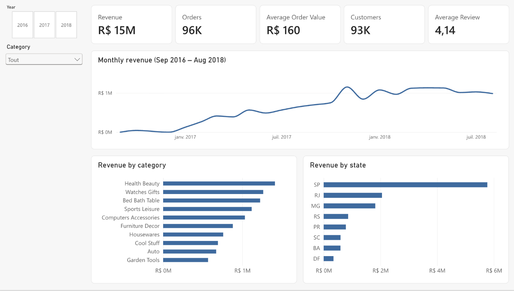
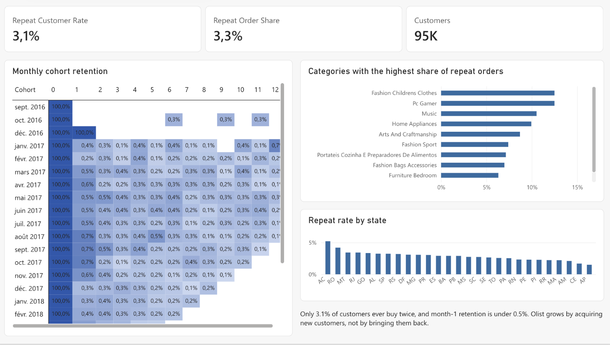
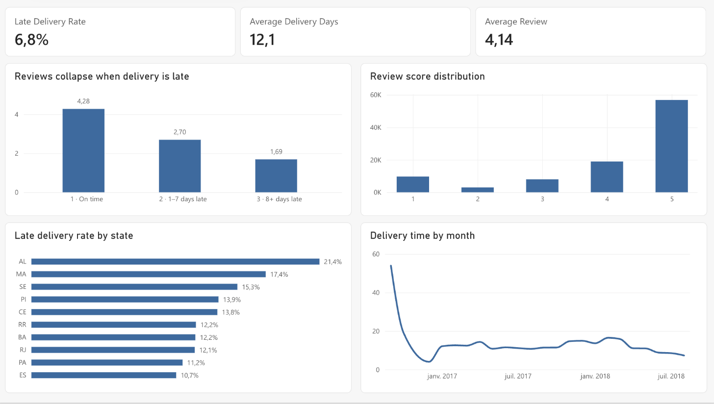

# Olist E-commerce Analysis — Power BI

A 3-page Power BI report on the [Olist Brazilian E-commerce public dataset](https://www.kaggle.com/datasets/olistbr/brazilian-ecommerce): ~100k orders from a Brazilian marketplace, September 2016 to August 2018. Built as a learning case study on public data; Olist is not a client.

**Report:** built and published in Power BI Service. The screenshots below show each page.

## Questions

1. Where does revenue come from, and how did it grow?
2. Do customers come back?
3. What drives bad reviews?

## Findings

- **R$15.4M** delivered revenue across **96,478** orders; average order value **R$160**.
- Revenue grew about **8x in a year** (R$127k in Jan 2017 to R$1.08M in Jan 2018), peaking at **R$1.15M in November 2017** (Black Friday).
- **São Paulo is 37%** of revenue; SP, RJ and MG together are 63%.
- **Only 3.1% of customers ever buy twice.** Month-1 retention is under 0.5%. Growth comes from acquisition, not retention.
- **6.8%** of orders arrive after the estimated date. Average delivery time is 12.1 days.
- **Late delivery is the strongest driver of bad reviews:** average review 4.28 when on time, 2.70 when 1–7 days late, 1.69 when 8+ days late.

## Pages

### Overview
Revenue, orders, AOV, customers, reviews; trend by month; revenue by category and state.

### Customers & retention
Repeat rate, monthly cohort retention matrix, repeat behaviour by category and state.

### Delivery & satisfaction
Late delivery rate, delivery time by month, review score by delay bucket.

## Data model

Star schema built in Python (pandas) from the 9 raw CSVs, then loaded into Power BI from one Excel workbook (`Olist_PowerBI_Data.xlsx`).

- `Sales` — fact table at order-item grain (112,650 rows): price, freight, revenue, order status, delivery dates and delay, review score, payment type, customer order rank and cohort month
- `Customers` — 96,096 rows: city, state, first order date, cohort month, total orders, repeat flag
- `Products` — 32,951 rows: category (English), dimensions, photos
- `Sellers` — 3,095 rows: city, state
- `Dates` — calendar table, marked as date table
- `_Measures` — dedicated table holding all measures

Relationships: `Sales` to `Customers`, `Products`, `Sellers` and `Dates`, all many-to-one, single direction.

16 DAX measures (`measures.dax`): revenue, orders, AOV, repeat rate, average review, late delivery rate, delivery days, month-over-month growth, cohort size and retention %. Plus one calculated column, `Delay Bucket`.

## Files

- `Olist_PowerBI_Data.xlsx` — modeled data, 5 tables
- `measures.dax` — all measures and the calculated column
- `screenshots/` — one image per page
